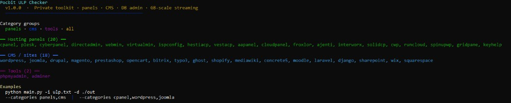
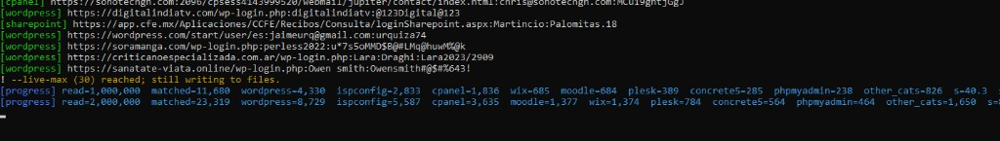

# Pocbit ULP Checker

**Private** Python toolkit to split large **ULP** (URL / login / password) dumps into **hosting panels** (cPanel, Plesk, CyberPanel, DirectAdmin, …), **CMS** sites (WordPress, Joomla, …), and **DB admin** tools (phpMyAdmin, Adminer). Optional helpers normalize lines for panel checkers and test cPanel/Plesk logins.

Category rules and port behavior: **[CATEGORIES.md](CATEGORIES.md)**

## Screenshots

**Category list** — `python main.py --list-categories` (colored groups: panels, CMS, tools):



**Live run** — matches on **stdout** (`[wordpress]`, `[cpanel]`, …), **`[progress]`** on stderr every N lines; `--live-max` warning when the cap is hit:



---

## What `main.py` does

- Reads **`ulp.txt`** (or `-i`) **once**, line by line — suitable for **multi‑GB** files and low RAM use.
- Classifies each non-empty line with rules in `ulp_classify.py`.
- Writes matches to **`{prefix}{category}.txt`** under the output directory (default prefix: `ulp_`).
- **One line can match several categories** (e.g. cPanel port + WordPress path); it is written to every matching file.
- Progress, banner, and summary go to **stderr**; live matched lines go to **stdout** when `--live` is on.

---

## Requirements

- **Python 3.10+**
- Dependencies: `requests`, `colorama`, `termcolor`

```bash
cd ULP-Checker-main
pip install -r requirements.txt
```

---

## Input format

Plain text, **one credential row per line**. Empty lines and lines starting with `#` are skipped.

Common shapes (mixing formats in one file is fine):

| Style | Example |
|--------|---------|
| Pipe ULP | `https://host:2083\|user\|pass` |
| Colon ULP | `host:8443:user:pass` |
| URL + path + creds | `https://site.com/wp-login.php:user:pass` |
| Path hints | `host/cpanel/:user:pass`, `host/smb/:user:pass` |

**Default input path:** `ulp.txt` in the same folder as `main.py`.  
If you run `python main.py` without `-i` and that file is missing, you get a colored error and hints on stderr.

---

## Usage — `main.py` (recommended)

### List categories

Prints the Pocbit banner, group names, and all **40** category keys (20 panels, 18 CMS, 2 tools):

```bash
python main.py --list-categories
```

See [screenshot above](#screenshots).

**Groups** (use with `--categories`):

| Group | Expands to |
|--------|------------|
| `panels` | All hosting panel categories |
| `cms` | All CMS / site categories |
| `tools` | `phpmyadmin`, `adminer` |
| `all` | Everything above |

You can also pass a comma list: `--categories cpanel,wordpress,joomla`.

---

### Basic split

```bash
# Write ulp_*.txt into ./out/
python main.py -i ulp.txt -d ./out
```

**Output directory (`-d`):** If omitted, files are written next to the **input file** (same folder as `ulp.txt`), not necessarily the project root.

**Output names:** `{out-dir}/{prefix}{category}.txt`  
Example: `./out/ulp_wordpress.txt`, `./out/ulp_cpanel.txt`.

Only categories with **at least one match** get non-empty files; the final summary lists sizes and line counts.

---

### Live terminal output

By default, matching lines are printed to **stdout** (tags in color), up to **`--live-max`** lines (default **5000**).

```bash
# Default: live on, max 5000 lines
python main.py -i ulp.txt -d ./out

# No terminal spam; files only
python main.py -i ulp.txt -d ./out --no-live

# Print all matches (can be huge)
python main.py -i ulp.txt -d ./out --live-max 0
```

With **`--other`**, unmatched lines go to `ulp_other.txt`. Add **`--live-other`** to print those to stdout too (still subject to `--live-max`).

---

### Scope: panels only, CMS only, or custom

```bash
python main.py -i ulp.txt -d ./out --categories panels
python main.py -i ulp.txt -d ./out --categories cms
python main.py -i ulp.txt -d ./out --categories tools

python main.py -i ulp.txt -d ./out --categories cpanel,plesk,cyberpanel,wordpress,joomla,phpmyadmin
```

---

### Progress and statistics

```bash
# Progress every 500k lines (default: 1_000_000; 0 = off)
python main.py -i ulp.txt -d ./out --progress-every 500000

# Count matches only — no category files written
python main.py -i ulp.txt --stats-only --progress-every 2000000

# Save machine-readable summary
python main.py -i ulp.txt -d ./out --json-summary split_stats.json
```

JSON summary includes counts per category, `read`, `matched_any`, `multi_label`, `elapsed_s`, paths, and `live_printed`.

---

### Unmatched (“other”) bucket

```bash
python main.py -i ulp.txt -d ./out --other
```

Creates **`ulp_other.txt`** (with default prefix) for lines that did not match any active category.

---

### `main.py` flags (reference)

| Flag | Default | Description |
|------|---------|-------------|
| `-i`, `--input` | `./ulp.txt` | Source ULP file |
| `-d`, `--out-dir` | Input file’s directory | Where `ulp_*.txt` are written |
| `--prefix` | `ulp_` | Filename prefix before category name |
| `--categories` | All 40 categories | `panels`, `cms`, `tools`, `all`, or comma list |
| `--list-categories` | — | Print categories and exit |
| `--other` | off | Write non-matching lines to `ulp_other.txt` |
| `--progress-every N` | `1000000` | stderr progress every N lines (`0` = off) |
| `--stats-only` | off | Count only; no output files |
| `--json-summary PATH` | — | Write summary JSON |
| `--live` / `--no-live` | live **on** | Print matches to stdout |
| `--live-max N` | `5000` | Cap live lines (`0` = unlimited) |
| `--live-other` | off | With `--other`, also print unmatched to stdout |

**Classification note:** Ports like **8080**, **8090**, **8443** often need URL/path **hints**; see [CATEGORIES.md](CATEGORIES.md) to avoid false positives.

---

## Terminal output (Windows / PowerShell)

- **stderr:** Pocbit banner, `●` info (input/output/prefix/live), `[progress]`, `✓` done summary, `✗` errors with `→` hints.
- **stdout:** Live `[category,...] line` when `--live` is enabled.
- Colors use **colorama** (works in modern Windows Terminal / PowerShell).

Example during a large split: [live progress screenshot](docs/live-progress.png).

Example when input is missing:

```text
Pocbit ULP Checker
v1.0.0  ·  Private toolkit · ...
● Input:  C:\...\ulp.txt
✗ Input not found: ...
  → Place ulp.txt here or run: python main.py -i C:\path\to\ulp.txt -d .\out
```

---

## Other scripts in this repo

| File | Role |
|------|------|
| **`main.py`** | **Use this** for full GB split in one pass |
| `ulp_classify.py` | Rules library (imported by `main.py`) |
| `format_cpanel_piped.py` | `ulp_cpanel.txt` → `https://host:port\|user\|pass` |
| `format_plesk_piped.py` | `ulp_plesk.txt` → `http(s)://host:port\|user\|pass` |
| `cpanel.py` | cPanel login checker → success file |
| `plesk.py` | Plesk login checker → success file |

### Format for checkers

```bash
python format_cpanel_piped.py -i ulp_cpanel.txt -o ulp_cpanel_piped.txt
python format_plesk_piped.py -i ulp_plesk.txt -o ulp_plesk_piped.txt
```

Expected checker line format: **`https://host:port|user|password`** (see script help).

### Login checkers

```bash
python cpanel.py -f ulp_cpanel_piped.txt --threads 10 -o cpanel_success.txt
python plesk.py -f ulp_plesk_piped.txt --threads 10 -o plesk_success.txt
```

- **`cpanel.py`:** `-f` / `--file`, `-o`, `--threads`, optional `--check-updates`
- **`plesk.py`:** `-f`, `-o`, `--threads`, `--append` (append successes instead of truncating)

Use checkers only on targets you are **authorized** to test.

---

## Typical workflow

1. **Split:** `python main.py -i ulp.txt -d ./out` (optionally `--categories panels,cms`).
2. **Inspect:** Check stderr summary; spot-check `./out/ulp_wordpress.txt`, `./out/ulp_cpanel.txt`, etc.
3. **Normalize panels:** Run `format_*_piped.py` on panel outputs you will check.
4. **Verify logins:** `cpanel.py` / `plesk.py` on piped lists.
5. **WordPress / other CMS:** Use your own checker or tools outside this repo (e.g. formatted WP lists); split output is still raw ULP lines.

Optional: `--other` to review leftovers; `--json-summary` for dashboards or diffing two dumps.

---

## Tips

- **Large runs:** Prefer `--no-live` and rely on files + `--progress-every`; live mode is for sampling.
- **Disk flush:** Output uses line buffering and periodic flush so files on Windows do not stay at 0 KB during long runs.
- **Multi-label:** High `multi_label` in the summary is normal when URLs contain both panel ports and CMS paths; narrow `--categories` if you want cleaner single-purpose files.
- **Help:** `python main.py -h` for all defaults (ArgumentDefaultsHelpFormatter).
- **Git:** `ulp.txt`, `ulp_*.txt`, `out/`, and checker success files are in `.gitignore` — keep dumps local only.

---

## Quick command cheat sheet

```bash
python main.py --list-categories
python main.py -i ulp.txt -d ./out
python main.py -i ulp.txt -d ./out --no-live --progress-every 500000
python main.py -i ulp.txt -d ./out --categories cms --other --json-summary stats.json
python main.py -i ulp.txt --stats-only
```
